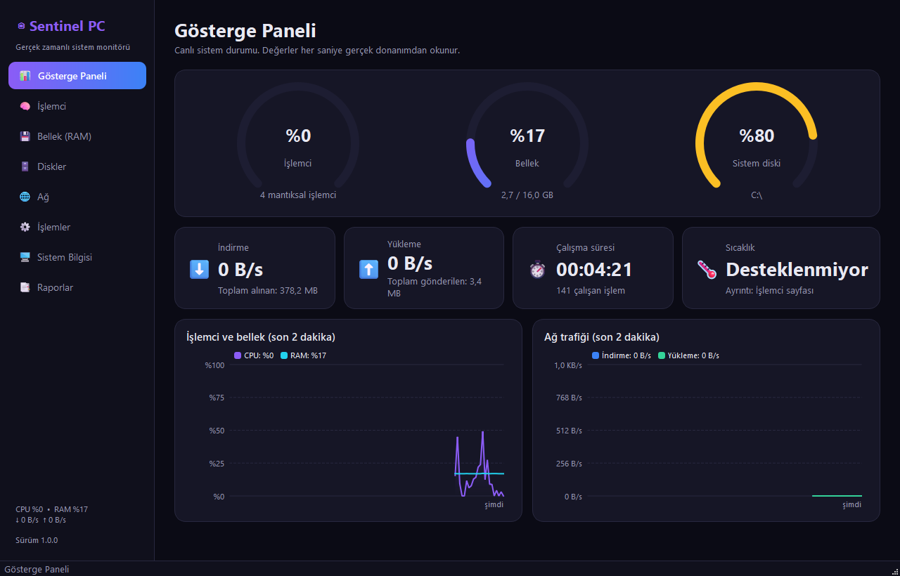
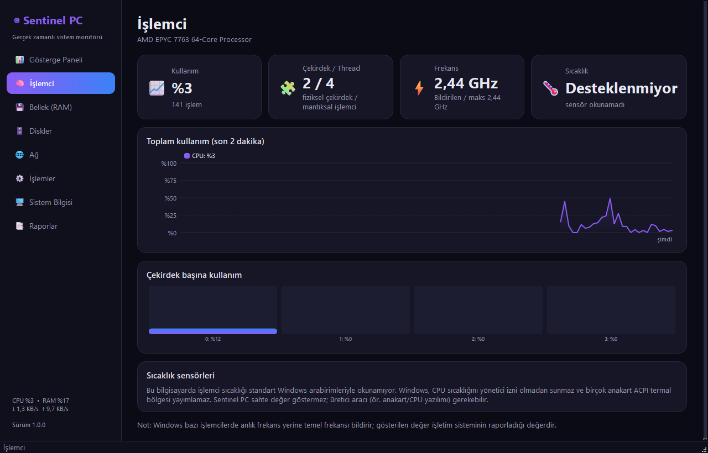
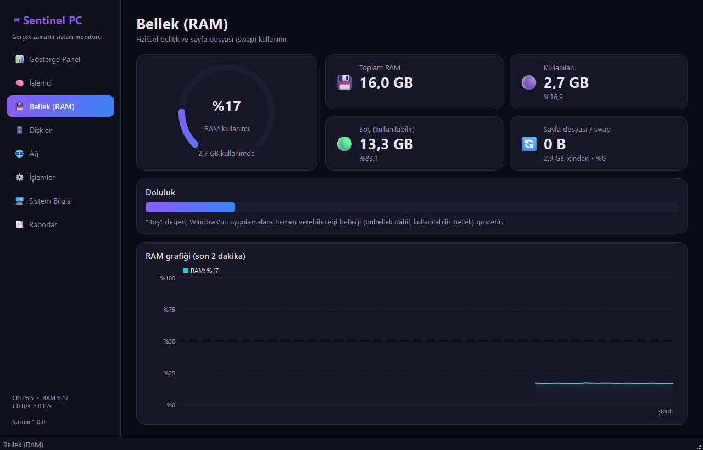
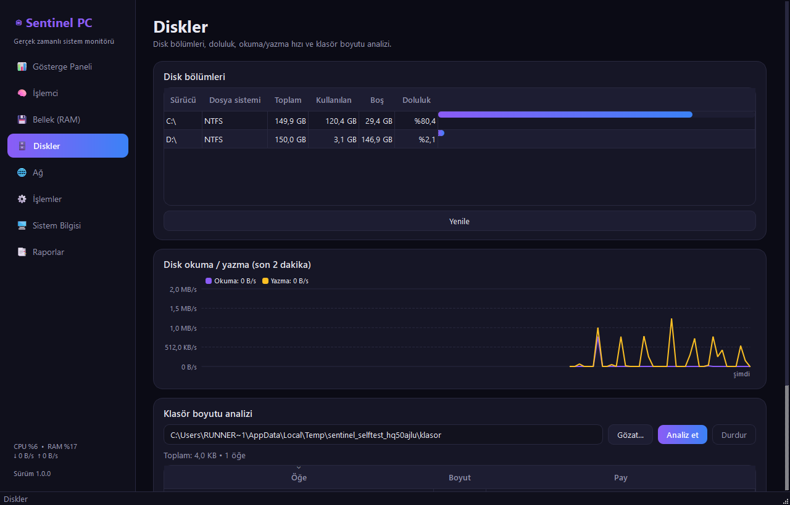
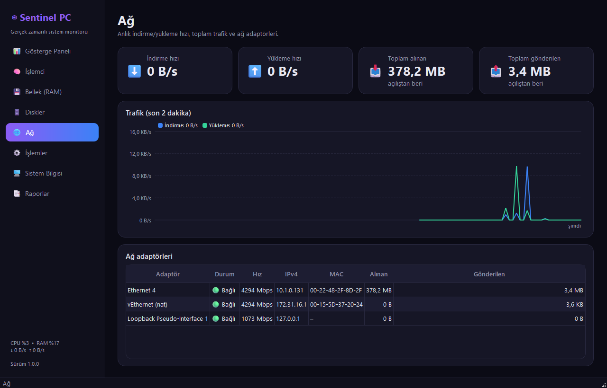
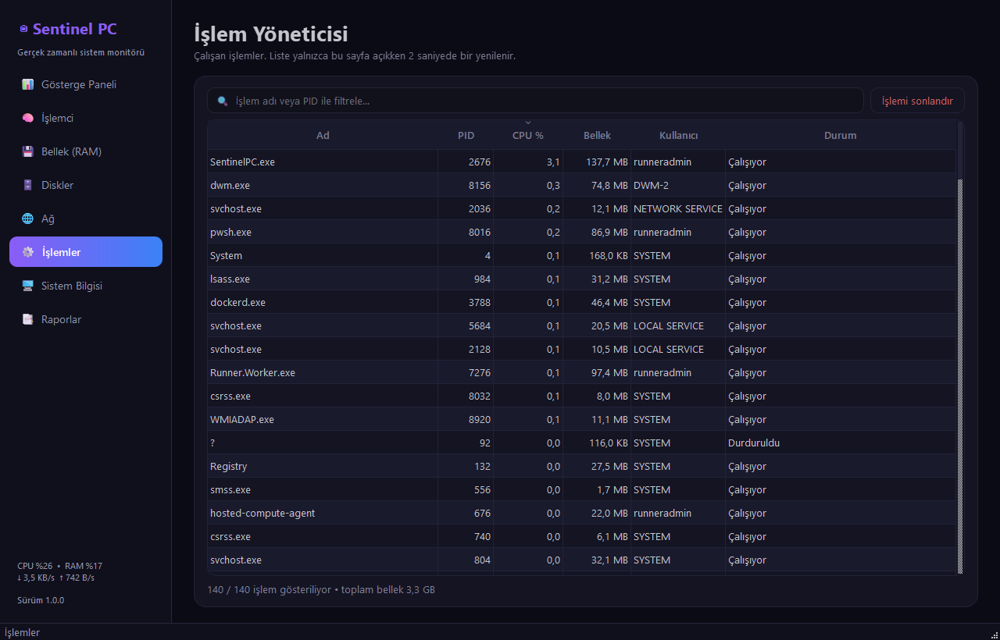
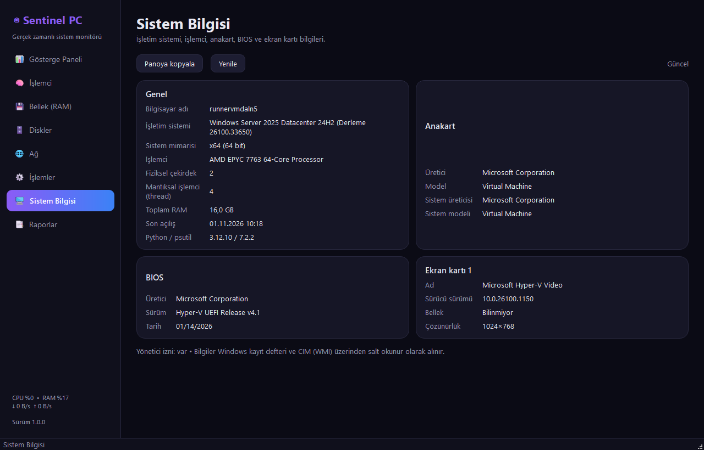
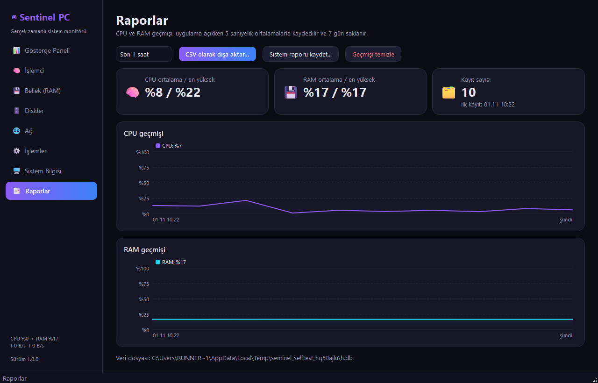

# Sentinel PC – Gerçek Zamanlı Sistem Monitörü

[](https://github.com/Enskygr234/sentinel-pc-windows/actions/workflows/windows.yml)

Bilgisayarınızın işlemci, bellek, disk ve ağ kullanımını **gerçek donanım verileriyle** canlı izleyen,
Türkçe arayüzlü, premium koyu temalı bir Windows 10/11 uygulaması. Tamamen çevrimdışı çalışır, yönetici izni istemez.

## İndir

**[Son sürüm → Releases](https://github.com/Enskygr234/sentinel-pc-windows/releases/latest)** → `SentinelPC-vX.Y.Z.exe`

Kurulum gerekmez; EXE'yi çalıştırın. Geçmiş kayıtları `%LOCALAPPDATA%\SentinelPC` içinde tutulur.

> **Kod imzası hakkında:** EXE bir kod imzalama sertifikasıyla **imzalanmamıştır** (sertifika mevcut değil).
> Windows SmartScreen ilk açılışta uyarı gösterebilir: **Ek bilgi → Yine de çalıştır**.
> Dosyayı Release'teki `SHA256SUMS.txt` ile doğrulayabilirsiniz.

## Ekran görüntüleri

Derlenen EXE'nin CI'daki self-test çalışması sırasında gerçek Windows üzerinde alınır (`screenshots` dalı):



<p>      </p>

## Özellikler

| Sayfa | İçerik |
|---|---|
| 📊 **Gösterge Paneli** | CPU, RAM ve sistem diski göstergeleri; anlık indirme/yükleme hızı; çalışma süresi; sıcaklık durumu; CPU+RAM ve ağ için canlı grafikler |
| 🧠 **İşlemci** | Model, fiziksel çekirdek ve thread sayısı, bildirilen frekans, toplam kullanım grafiği, çekirdek başına kullanım çubukları, sıcaklık sensörleri (destekleniyorsa) |
| 💾 **Bellek** | Toplam / kullanılan / boş (kullanılabilir) RAM, sayfa dosyası, doluluk çubuğu, RAM grafiği |
| 🗄️ **Diskler** | Tüm bölümler (dosya sistemi, toplam, kullanılan, boş, doluluk), okuma/yazma hızı grafiği, klasör boyutu analizi (durdurulabilir, salt okunur) |
| 🌐 **Ağ** | İndirme/yükleme hızı, açılıştan beri toplam trafik, trafik grafiği, ağ adaptörleri (durum, hız, IPv4, MAC, trafik) |
| ⚙️ **İşlemler** | Ad, PID, CPU %, bellek, kullanıcı, durum; filtreleme ve sıralama; **onay penceresiyle** işlem sonlandırma |
| 🖥️ **Sistem Bilgisi** | Windows sürümü ve derlemesi, işlemci modeli, anakart, BIOS, ekran kartı (sürücü, bellek, çözünürlük), mimari; panoya kopyalama |
| 📑 **Raporlar** | 15 dk – 7 gün aralığında CPU/RAM geçmişi grafikleri, ortalama/en yüksek değerler, **CSV dışa aktarma** (Excel uyumlu), **sistem raporu** (.txt) |

## Veri doğruluğu ilkeleri

- Tüm ölçümler `psutil` ve Windows API/kayıt defteri/CIM üzerinden **gerçek donanımdan** okunur; hiçbir değer üretilmez veya tahmin edilmez.
- **Sıcaklık:** Windows, CPU sıcaklığını yönetici izni olmadan standart bir arabirimle sunmaz. Sentinel yalnızca okunabilen
  gerçek sensörleri (ACPI termal bölgeleri) gösterir. Okunamıyorsa arayüzde açıkça **"Desteklenmiyor"** yazar ve nedenini açıklar.
- **Frekans:** Bazı işlemcilerde Windows anlık değil temel frekansı bildirir; arayüz bunu "Bildirilen" olarak etiketler.
- **Ekran kartı belleği:** Windows'un `AdapterRAM` alanı 4 GB ile sınırlıdır; bu durumda değer "≥ 4 GB" olarak belirtilir.
- Okunamayan alanlar "Bilinmiyor" olarak gösterilir.

## Güvenlik ve performans

- Yönetici izni istenmez; tüm bilgiler normal kullanıcı haklarıyla okunur.
- İşlem sonlandırma yalnızca kullanıcı onayıyla yapılır; önce nazikçe sonlandırma denenir, yanıt yoksa ayrıca onayla zorla sonlandırma sorulur.
  Kritik sistem işlemleri (csrss, lsass, winlogon, services…) ve Sentinel'in kendisi korunur.
- Tek bir 1 saniyelik zamanlayıcı kullanılır; yalnızca görünen sayfa güncellenir, simge durumundayken çizim yapılmaz.
- İşlem listesi yalnızca İşlemler sayfası açıkken ve arka plan iş parçacığında, 2 saniyede bir okunur.
- Sistem bilgisi ve sıcaklık sorguları arka planda çalışır; arayüz donmaz.
- Geçmiş, 5 saniyelik ortalamalar halinde yazılır (disk yükü düşük) ve 7 günden eski kayıtlar otomatik silinir.

## Kaynaktan çalıştırma

```powershell
python -m venv .venv
.venv\Scripts\activate
pip install -r requirements.txt
python run.py
```

## Test

```powershell
pip install -r requirements-dev.txt
python -m pytest -v
SentinelPC.exe --self-test=rapor.json     # derlenmiş EXE'nin kendi kendini doğrulaması
```

- `tests/test_core.py`: hız hesaplama, gerçek ölçüm aralıkları, bölümler, adaptörler, işlem listesi, işlem koruması,
  çocuk işlem sonlandırma, klasör boyutu, sistem bilgisi, sıcaklığın sahte değer döndürmemesi, geçmiş/CSV/rapor
- `tests/test_ui.py`: uygulamayı ekransız açar; canlı veri, tüm sayfalar, işlem listesi ve filtre, sistem bilgisi,
  sıcaklık durumu, disk/klasör analizi, ağ adaptörleri, geçmiş kaydı, CSV ve rapor üretimi

## GitHub Actions

`.github/workflows/windows.yml` her push'ta Windows runner'da testleri çalıştırır, PyInstaller ile EXE üretir,
**EXE'yi `--self-test` ile gerçekten açıp doğrular**, artifact olarak yükler; `VERSION` dosyasındaki sürüm henüz
yayınlanmamışsa (veya `v*` etiketi gönderildiğinde) GitHub Releases'e ekler ve sayfa görüntülerini `screenshots` dalına yayınlar.

Yeni sürüm için `VERSION`, `sentinel/__init__.py` ve `version_info.txt` içindeki sürümü artırıp `main`'e gönderin.

## Proje yapısı

```
sentinel/
├── core/
│   ├── metrics.py      psutil ölçümleri, hız hesabı, bölümler, adaptörler, işlemler, klasör boyutu
│   ├── sysinfo.py      Windows sürümü, CPU modeli, anakart, BIOS, ekran kartı
│   ├── temperature.py  gerçek sensör okuma / açık "desteklenmiyor" bildirimi
│   └── history.py      SQLite geçmiş, CSV, sistem raporu
├── ui/                 tema, grafik ve gösterge bileşenleri, sayfalar
├── selftest.py
└── main.py
```

## Lisans

MIT – bkz. [LICENSE](LICENSE).
